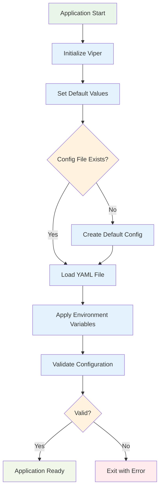

# Backend Configuration Guide

[← Back to Documentation](./README.md)

DataHarbor's Go backend uses a unified configuration system built on [Viper](https://github.com/spf13/viper) that supports YAML files, environment variables, and validation. This guide provides a complete reference for all backend configuration options.

## Quick Start

### Basic Setup

1. **Copy a template configuration**:

   ```bash
   # For development
   cp app/config/application.development.yaml app/config/application.yaml

   # For production
   cp app/config/application.production.yaml app/config/application.yaml
   ```

2. **Set environment variables** (optional):

   ```bash
   export DATAHARBOR_SERVER_ADDRESS=":8081"
   export DATAHARBOR_AUTH_ENABLED="true"
   ```

3. **Run with custom config**:

   ```bash
   # Start backend dev server (uses default config)
   make dev-backend

   # Or run with a specific config file
   cd app && go run . --config=config/application.yaml
   ```

## Configuration Architecture

### Loading Priority

Configuration values are loaded in the following order (highest to lowest priority):

1. **Environment Variables** (`DATAHARBOR_*`)
2. **YAML Configuration File**
3. **Default Values** (hardcoded)

### Configuration Flow



## Complete Configuration Reference

### Global Settings

| Key   | Type   | Default         | Description                                                      |
| ----- | ------ | --------------- | ---------------------------------------------------------------- |
| `env` | string | `"development"` | Application environment (`development`, `production`, `testing`) |

### Server Configuration (`server`)

| Key                       | Type   | Default   | Description                             |
| ------------------------- | ------ | --------- | --------------------------------------- |
| `server.address`          | string | `":8080"` | Server bind address and port            |
| `server.debug`            | bool   | `false`   | Enable debug mode: logs request and response headers and bodies at debug level, with credentials redacted (see [Log redaction](#log-redaction)) |
| `server.debug_body_log_limit` | int | `4096` | Debug mode only: the most bytes of each request and response body that are kept and logged. A longer body is still passed through whole; its log line is cut at this size and ends with `... (truncated)`. Zero or negative means `4096`; the maximum is `1048576` (1 MiB), and a larger value is silently clamped to it (see [Debug body logging](#debug-body-logging)) |
| `server.shutdown_timeout` | string | `"30s"`   | How long to wait for in-flight requests after SIGINT or SIGTERM, as a Go duration (`45s`, `2m`). An empty, malformed or non-positive value falls back to `30s` with a warning (see [Graceful shutdown](#graceful-shutdown)) |

#### CORS Settings (`server.cors`)

| Key                             | Type     | Default | Description                        |
| ------------------------------- | -------- | ------- | ---------------------------------- |
| `server.cors.allow_credentials` | bool     | `false` | Allow credentials in CORS requests |
| `server.cors.allow_origins`     | []string | `[]`    | Allowed origin domains for CORS    |
| `server.cors.allow_methods`     | []string | `[]`    | Allowed HTTP methods for CORS      |
| `server.cors.allow_headers`     | []string | `[]`    | Allowed HTTP headers for CORS      |

#### SSL Configuration (`server.ssl`)

| Key                    | Type   | Default | Description                  |
| ---------------------- | ------ | ------- | ---------------------------- |
| `server.ssl.enabled`   | bool   | `false` | Enable HTTPS/TLS encryption  |
| `server.ssl.cert_file` | string | `""`    | Path to SSL certificate file |
| `server.ssl.key_file`  | string | `""`    | Path to SSL private key file |

### Logging Configuration (`logging`)

| Key              | Type   | Default  | Description                                         |
| ---------------- | ------ | -------- | --------------------------------------------------- |
| `logging.level`  | string | `"info"` | Global log level (`debug`, `info`, `warn`, `error`) |
| `logging.format` | string | `"json"` | Global log format (`json`, `text`)                  |

#### Console Logging (`logging.console`)

| Key                       | Type   | Default  | Description                                   |
| ------------------------- | ------ | -------- | --------------------------------------------- |
| `logging.console.enabled` | bool   | `true`   | Enable console output                         |
| `logging.console.level`   | string | `"info"` | Console-specific log level (overrides global) |
| `logging.console.format`  | string | `"text"` | Console-specific format (overrides global)    |

#### File Logging (`logging.file`)

| Key                       | Type   | Default                  | Description                                |
| ------------------------- | ------ | ------------------------ | ------------------------------------------ |
| `logging.file.enabled`    | bool   | `false`                  | Enable file logging                        |
| `logging.file.level`      | string | `"info"`                 | File-specific log level (overrides global) |
| `logging.file.format`     | string | `"json"`                 | File-specific format (overrides global)    |
| `logging.file.filename`   | string | `"./log/dataharbor.log"` | Log file path                              |
| `logging.file.maxsize`    | int    | `10`                     | Maximum log file size in MB                |
| `logging.file.maxbackups` | int    | `5`                      | Number of backup files to retain           |
| `logging.file.maxage`     | int    | `30`                     | Days to retain old log files               |
| `logging.file.compress`   | bool   | `true`                   | Compress rotated log files                 |

#### Log redaction

The backend never writes a credential to its log, at any level. This is not
configurable.

- **Headers.** `Authorization` and `Proxy-Authorization` keep only the scheme
  (`Bearer [REDACTED]`). `Cookie` keeps the cookie names, never the values. `Set-Cookie`
  keeps the cookie name and its attributes (`Path`, `Domain`, ...), never the value. Any
  other header with a sensitive name is replaced entirely.
- **Bodies** (debug mode only). JSON and form bodies are logged with the values of
  sensitive fields replaced by `[REDACTED]`, at any nesting depth. A body is JSON when its
  `Content-Type` says so or when it starts with `{` or `[` (for example a `fetch()` body
  sent as `text/plain`). Any other body (HTML, plain text, binary, unparseable JSON) is not
  logged; only its size and media type are.
  File downloads and upload chunks are streamed: their bodies are never read or logged
  (see [Debug body logging](#debug-body-logging)).
- **Sensitive names.** Anything containing `token`, `secret`, `password`, `cookie`,
  `session`, `credential`, `authorization`, `signature` or `api key`, plus `code`,
  `state`, `nonce`, `key`, `auth` and similar. In JSON, `code` and `state` are redacted
  only when they hold a string, so the numeric `code` of the API envelope stays visible.
  The upload status field `"state": "uploading"` is therefore shown as `[REDACTED]` in
  debug body logs.
- **URLs and error text.** Sensitive query parameters (`code`, `state`,
  `id_token_hint`, `access_token`, …) are redacted wherever a URL is logged, including
  inside error messages and identity-provider responses.
- **Safety net.** Every log message also passes through a filter that removes bearer
  credentials, JWTs, `dh_cli_` tokens, PEM blocks, URL userinfo (`https://user@host` is
  logged as `https://[REDACTED]@host`) and `key=value` pairs with a sensitive key, in
  case a log statement forgets to redact. It can occasionally hide a harmless word that
  follows such a key: a session-cookie error such as `securecookie: the value is not
  valid` is logged as `securecookie: [REDACTED] value is not valid`.
- **Panics.** A recovered panic is logged through the backend logger with the method,
  path and stack. The request itself (headers, query string) is not dumped.

The helpers live in `app/common/redact.go`. To check a running development backend,
run `make log-redaction-probe`: it sends requests carrying a one-off sentinel as bearer
token, cookie, query parameter and JSON field, then searches the log file and prints
`PASS`, `FAIL` or `INCONCLUSIVE`. It needs `server.debug: true` and debug-level logging;
set `LOG_PROBE_BASE_URL` and `LOG_PROBE_LOG_FILE` if the defaults
(`https://localhost:22000`, `app/log/dataharbor_app.log`) do not match.

#### Debug body logging

With `server.debug: true` the backend logs each request's method, path, headers, status
and duration, plus the start of its request and response bodies. Memory per request
stays bounded by `server.debug_body_log_limit`, however large the body:

- **Transfer routes are never captured.** `GET /api/v1/xrd/download`,
  `POST /api/v1/xrd/download/batch` and `PUT /api/v1/xrd/upload/{uploadId}/chunk` keep
  their request line, headers and status in the log, but their bodies are neither read
  nor buffered. The routes are matched by their registered route, not by a path prefix,
  and are marked where they are registered (`handleStreaming` in `app/route/routes.go`).
- **Only JSON and form bodies are captured.** A body counts as JSON when its
  `Content-Type` mentions `json`, or, whatever its type (or with none), when its first
  non-whitespace byte is `{` or `[`. `fetch()` sends a JSON string body as
  `text/plain;charset=UTF-8`, so such a body is logged, redacted the same way. For any
  other request body the logger reads only enough to see that first byte (512 bytes at a
  time) and hands those bytes on to the handler; the log shows only the declared size and
  media type (nothing when the size is unknown). Responses of other types are not kept.
  A body that starts like JSON but does not parse is never logged raw: whole, it becomes a
  size line; cut by the limit, only its complete, redacted JSON tokens are shown.
- **Bodies are capped.** At most `server.debug_body_log_limit` bytes of each body are kept
  (at most 1 MiB, whatever the setting). Capture buffers grow with the body, so a small
  body does not reserve the whole limit.
  The request body is handed to the handler whole. A body longer than the limit is
  logged up to the last complete JSON value or form field before the cut and is marked
  `... (truncated)`. A value cut by the limit is dropped, never shown in part, so no prefix
  of a credential reaches the log. If nothing complete fits, the log line is
  `[more than N bytes of <type>, truncated, not logged]`.

To check a running development backend, run `make debug-body-probe` (see
`scripts/probe-debug-body.sh`). It sends an upload chunk and an oversized JSON body,
unauthenticated, and checks that the chunk produced no body log line and that the JSON
body was logged truncated with no fragment of a sentinel placed past the limit.

#### Graceful shutdown

On the first SIGINT or SIGTERM the backend stops accepting new connections and waits for
in-flight requests, including downloads and upload chunks, for up to
`server.shutdown_timeout`. A request counts as finished only when its response has
reached the client: on Linux the backend also waits until the data it has written to
each connection has been acknowledged. Without that wait, the last megabytes of a
download to a slow client would be lost when a container is removed with the process.

- **Drained in time.** The upload janitor is stopped, `Shutdown complete: all requests
  drained` is logged and the process exits with status 0.
- **Deadline reached.** The remaining connections are closed, `Shutdown deadline reached:
  remaining requests were cut` is logged with the number of requests still in flight
  and of responses not fully delivered, and the process exits with status 1. Cut
  connections are reset, so a proxy in front reports the failure to its client at once
  and does not wait for its read timeout.
- **Second signal.** A second SIGINT or SIGTERM during the drain kills the process
  immediately.

The start is logged as `Shutdown started: no new connections are accepted`, with the
timeout and the number of in-flight requests.

The supervisor must wait longer than `server.shutdown_timeout` before it sends SIGKILL:

- Docker stops a container after 10 seconds by default. Set `stop_grace_period` (the
  compose files use `40s`) or pass `docker stop -t`.
- systemd waits 90 seconds by default (`TimeoutStopSec`), which covers the default
  timeout. Set `TimeoutStopSec` in the unit if you raise `server.shutdown_timeout`
  beyond that.

A transfer that needs longer than the timeout is still cut, and a download cut at the
deadline has to be retried. Upload sessions are held in memory and are lost on every
restart, drained or not. If you restart during long transfers, raise both
`server.shutdown_timeout` and the supervisor's kill delay.

To check a running backend, run `make shutdown-probe`. It starts a slow download, stops
the backend and checks that the download finishes and that new connections are refused.
It stops the backend, so it only runs with `SHUTDOWN_PROBE_FLAGS=--stop-backend`; see
the header of `scripts/probe-graceful-shutdown.sh` for the environment variables.

### XRootD Configuration (`xrd`)

| Key                 | Type   | Default       | Description                               |
| ------------------- | ------ | ------------- | ----------------------------------------- |
| `xrd.host`          | string | `"localhost"` | **Required** XRootD server hostname       |
| `xrd.port`          | uint   | `1094`        | **Required** XRootD server port           |
| `xrd.initial_dir`   | string | `"/tmp"`      | Default directory for file operations     |
| `xrd.user`          | string | `""`          | XRootD username for authentication        |
| `xrd.usergroup`     | string | `""`          | XRootD user group                         |
| `xrd.user_required` | bool   | `false`       | Require user authentication for XRootD    |
| `xrd.tls`           | bool   | `false`       | Enable TLS for XRootD connections         |
| `xrd.client_cert`   | string | `""`          | Path to client certificate for XRootD TLS |
| `xrd.client_key`    | string | `""`          | Path to client key for XRootD TLS         |

#### Upload Settings (`xrd.upload`)

Controls the server-side multi-file chunked upload feature. See
[UPLOAD.md](./UPLOAD.md) for the end-to-end flow.

| Key                                  | Type   | Default        | Description                                                     |
| ------------------------------------ | ------ | -------------- | --------------------------------------------------------------- |
| `xrd.upload.enabled`                 | bool   | `true`         | Master switch for the upload feature.                           |
| `xrd.upload.max_file_size`           | int64  | `53687091200`  | Maximum per-file size in bytes (default 50 GiB).                |
| `xrd.upload.max_batch_size`          | int64  | `107374182400` | Maximum aggregate batch size in bytes (default 100 GiB).        |
| `xrd.upload.max_files_per_batch`     | int    | `100`          | Maximum number of files in a single batch.                      |
| `xrd.upload.max_concurrent_per_user` | int    | `2`            | Concurrent upload **sessions** allowed per user (`0` disables cap). One slot is taken per session and shared by all files in that batch, so a batch may contain far more files than this cap. |
| `xrd.upload.chunk_size`              | int64  | `8388608`      | Maximum chunk size accepted by the server (default 8 MiB).      |
| `xrd.upload.session_ttl`             | string | `"2h"`         | Absolute maximum session lifetime; sessions older than this are reaped regardless of activity. |
| `xrd.upload.idle_ttl`                | string | `"10m"`        | Maximum time a session may go without a committed chunk before being reaped. Bounds resources held by abandoned sessions. `0` disables idle reaping. |
| `xrd.upload.temp_suffix`             | string | `".dh-upload"` | Suffix for the server-side temp file during upload. A unique per-session id is appended so concurrent uploads never collide. |
| `xrd.upload.allow_overwrite`         | bool   | `false`        | Whether the `overwrite` conflict action is permitted.           |
| `xrd.upload.checksum_algo`           | string | `"sha256"`     | Client-supplied checksum algorithm; only `sha256` is supported. |

### Authentication Configuration (`auth`)

| Key                    | Type     | Default       | Description                      |
| ---------------------- | -------- | ------------- | -------------------------------- |
| `auth.enabled`         | bool     | `false`       | Enable authentication system     |
| `auth.skip_auth_paths` | []string | `["/health"]` | Paths that bypass authentication |

#### OIDC Settings (`auth.oidc`)

| Key                                  | Type     | Default | Description                                    |
| ------------------------------------ | -------- | ------- | ---------------------------------------------- |
| `auth.oidc.issuer`                   | string   | `""`    | **Required if auth enabled** OIDC issuer URL   |
| `auth.oidc.client_id`                | string   | `""`    | **Required if auth enabled** OIDC client ID    |
| `auth.oidc.client_secret`            | string   | `""`    | OIDC client secret (use env var in production) |
| `auth.oidc.discovery_url`            | string   | `""`    | OIDC discovery endpoint URL                    |
| `auth.oidc.allowed_roles`            | []string | `[]`    | List of allowed user roles                     |
| `auth.oidc.session_secret`           | string   | `""`    | Secret for session encryption (use env var)    |
| `auth.oidc.token_refresh_buffer_sec` | int64    | `60`    | Seconds before token expiry to refresh         |

### Frontend Configuration (`frontend`)

| Key                    | Type     | Default                   | Description                                                                                                                                                    |
| ---------------------- | -------- | ------------------------- | -------------------------------------------------------------------------------------------------------------------------------------------------------------- |
| `frontend.url`         | string   | `"http://localhost:5173"` | Frontend application URL. **IMPORTANT**: Set to production URL (e.g., `https://yourdomain.com`) for production deployments. This controls OAuth redirect URIs. |
| `frontend.asset_paths` | []string | `[]`                      | Additional paths to search for frontend assets                                                                                                                 |
| `frontend.dist_dir`    | string   | `"dist"`                  | Frontend build output directory                                                                                                                                |

**Note**: The `frontend.url` must match where users access your application. For development, use `http://localhost:5173` or `https://localhost:5173`. For production, use your actual domain like `https://yourdomain.com` or `https://punch2.gsi.de`. This URL is used for OAuth/OIDC redirect URIs after authentication.

## Environment Variables

All configuration values can be overridden using environment variables with the `DATAHARBOR_` prefix.

### Naming Convention

- Prefix: `DATAHARBOR_`
- Replace dots (`.`) with underscores (`_`)
- Use UPPERCASE letters

### Common Environment Variables

```bash
# Server Configuration
export DATAHARBOR_SERVER_ADDRESS=":8081"
export DATAHARBOR_SERVER_DEBUG="true"
export DATAHARBOR_SERVER_DEBUG_BODY_LOG_LIMIT="4096"

# Logging Configuration
export DATAHARBOR_LOGGING_LEVEL="debug"
export DATAHARBOR_LOGGING_CONSOLE_ENABLED="true"
export DATAHARBOR_LOGGING_FILE_ENABLED="true"

# XRootD Configuration
export DATAHARBOR_XRD_HOST="xrootd.example.com"
export DATAHARBOR_XRD_PORT="1094"
export DATAHARBOR_XRD_USER_REQUIRED="true"

# Authentication Configuration
export DATAHARBOR_AUTH_ENABLED="true"
export DATAHARBOR_AUTH_OIDC_CLIENT_SECRET="your-secret-here"
export DATAHARBOR_AUTH_OIDC_SESSION_SECRET="your-session-secret"

# Frontend Configuration
export DATAHARBOR_FRONTEND_URL="https://yourdomain.com"  # Use production domain, not localhost:5173
```

**Important**: When deploying to production, always set `DATAHARBOR_FRONTEND_URL` to your actual domain. Using `localhost:5173` in production will cause OAuth/OIDC redirect failures.

## Configuration Validation

The application validates critical settings on startup:

### Required Fields

- `server.address` - Must not be empty
- `xrd.host` - Must not be empty
- `xrd.port` - Must be greater than 0

### Conditional Requirements

When `auth.enabled = true`:

- `auth.oidc.issuer` - Must not be empty
- `auth.oidc.client_id` - Must not be empty

### Validation Rules

- `logging.level` - Must be one of: `debug`, `info`, `warn`, `error`
- `logging.console.level` - Same as above (if specified)
- `logging.file.level` - Same as above (if specified)

### Error Handling

If validation fails:

1. Application logs the specific validation error
2. Application exits with error code 1
3. No fallback or default substitution occurs

## Example Configurations

### Development Configuration

```yaml
env: development

server:
  address: ":22000"
  debug: true
  cors:
    allow_credentials: true
    allow_origins:
      - "http://localhost:5173"
      - "https://localhost:5173"

logging:
  level: debug
  format: text
  console:
    enabled: true
    level: debug
    format: text
  file:
    enabled: true
    level: debug
    filename: "./log/dataharbor_dev.log"
    maxsize: 10
    maxbackups: 2
    maxage: 7

xrd:
  host: "localhost"
  port: 1094
  initial_dir: "/tmp"
  user_required: false

auth:
  enabled: true
  oidc:
    issuer: "https://id.gsi.de/realms/wl"
    client_id: "xrootd"
    session_secret: "dev-session-secret"
```

### Production Configuration

```yaml
env: production

server:
  address: ":8080"
  debug: false
  ssl:
    enabled: true
    cert_file: "/etc/ssl/dataharbor/server.crt"
    key_file: "/etc/ssl/dataharbor/server.key"
  cors:
    allow_credentials: true
    allow_origins:
      - "https://yourdomain.com"

logging:
  level: info
  format: json
  console:
    enabled: true
    level: info
    format: json
  file:
    enabled: true
    level: info
    filename: "/var/log/dataharbor/app.log"
    maxsize: 100
    maxbackups: 10
    maxage: 30

xrd:
  host: "xrootd-server.yourdomain.com"
  port: 1094
  initial_dir: "/data"
  user_required: true
  tls: true
  client_cert: "/etc/ssl/dataharbor/client.crt"
  client_key: "/etc/ssl/dataharbor/client.key"

auth:
  enabled: true
  oidc:
    issuer: "https://id.yourdomain.com/realms/prod"
    client_id: "dataharbor-prod"
    client_secret: "${DATAHARBOR_CLIENT_SECRET}"
    session_secret: "${DATAHARBOR_SESSION_SECRET}"

frontend:
  url: "https://yourdomain.com"  # CRITICAL: Must match your production domain
  asset_paths:
    - "/var/www/dataharbor"
```

## Common Configuration Issues

### OAuth/OIDC Redirect to Wrong URL

**Symptom**: After successful Keycloak authentication, the application redirects to `https://localhost:5173` instead of your production domain.

**Cause**: The `frontend.url` configuration is set to the development URL instead of the production URL.

**Solution**:

1. Edit your backend configuration file:
   ```bash
   sudo nano /root/dataharbor/config/backend-config-gsi-test-server.yaml
   ```

2. Update the `frontend.url` to match your production domain:
   ```yaml
   frontend:
     url: "https://punch2.gsi.de"  # Or your actual domain
   ```

3. Restart the backend service:
   ```bash
   sudo systemctl restart dataharbor-backend
   ```

**Prevention**: Always verify `frontend.url` matches where users access your application before deploying to production.

### Need Help?

For troubleshooting backend configuration issues, see the **[Troubleshooting Guide](./TROUBLESHOOTING.md)**.

## Related Documentation

- **[Frontend Configuration](./FRONTEND_CONFIGURATION.md)** - Vue.js application configuration
- **[Development Guide](./DEVELOPMENT.md)** - Development environment setup
- **[Deployment Guide](./DEPLOYMENT.md)** - Production deployment configuration

---

[← Back to Documentation](./README.md) | [↑ Top](#backend-configuration-guide)
