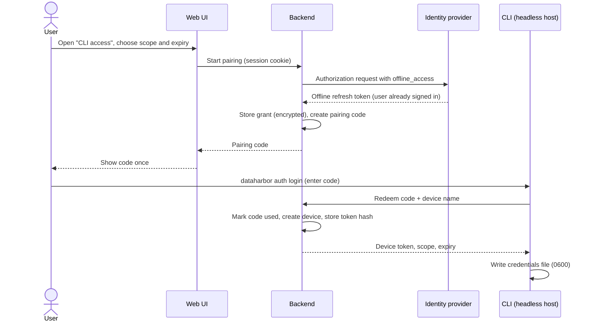

# CLI: Authentication

[← CLI documentation](./README.md)

> **Status: proposed.** Endpoint names and payloads are provisional until the
> specification ticket (CLI-F4) closes.

## Requirements

- CLI users are the same identities as web users (same OIDC identity provider).
- Works on hosts with no browser and no desktop keyring.
- Supports unattended runs lasting hours to days (cron, batch systems).
- Each CLI installation can be listed, scoped, expired and revoked independently.
- Identity-provider tokens are never stored on the user's host.

## Current state (backend v1.2.1)

- Login is the OIDC authorization-code flow with a confidential client, driven by the
  browser. The session is a signed cookie holding an id that points into an in-memory
  token map on the backend.
- The session middleware requires that cookie. There is no bearer-token, API-key or
  device-flow path.
- Every XRootD operation opens a connection authenticated with the user's own
  identity-provider access token (ZTN). The backend has no service credential.
- Access tokens are refreshed lazily when a request arrives. `offline_access` is not
  requested. A backend restart loses all tokens.

Consequence: whatever the CLI presents, the backend must hold a valid identity-provider
grant for that user, keep it refreshed, and keep it across restarts.

## Design

### Credentials

| Credential                  | Issued by          | Stored                              | Lifetime                         | Used for            |
| --------------------------- | ------------------ | ----------------------------------- | -------------------------------- | ------------------- |
| Pairing code                | DataHarbor backend | Shown once in the web UI            | About 10 minutes, single use     | Enrolling a device  |
| Device token (`dh_cli_…`)   | DataHarbor backend | CLI host, `0600` file; hash in DB   | Weeks to months (policy, Q7)     | CLI → backend       |
| Offline refresh token       | Identity provider  | Backend database, encrypted         | Identity-provider policy (Q1)    | Getting access tokens |
| Access token                | Identity provider  | Backend, short-lived cache          | Minutes to an hour               | Backend → XRootD    |

### Pairing flow



Notes:

- A refresh token belonging to the browser session cannot be copied for the device;
  it would die when the user logs out of the web UI. Each device therefore gets its own
  grant through a dedicated authorization round-trip at pairing time. The user is
  already signed in, so this is normally a redirect without a prompt (a consent screen
  may appear, depending on the client configuration).
- If the pairing code expires without being redeemed, the backend revokes the pending
  grant at the identity provider and deletes it.
- This step depends on open question Q1. If `offline_access` is not available, the
  fallback is a grant tied to the normal session lifetime, and unattended runs are
  limited to that lifetime.

### Authenticating a request

```
GET /api/v1/xrd/download?path=/data/run42.root
Authorization: Bearer dh_cli_<random>
```

The backend:

1. Hashes the token and looks up the device: user, scope, expiry, revoked flag.
2. Rejects the request if the scope does not allow the operation.
3. Loads the device's grant and obtains a current access token, refreshing if needed.
4. Performs the XRootD operation with that access token, as for a web session.
5. Records `last_used_at`, client version and source address for the device.

Session-cookie authentication keeps working unchanged. A request is authenticated by
exactly one of the two mechanisms.

### Token refresh

- Refresh is serialized per grant with a database row lock, so parallel chunk requests
  and several backend instances never use the same refresh token concurrently.
- If the identity provider rotates refresh tokens, the new one is persisted in the same
  transaction that releases the lock.
- A background task refreshes grants well inside the identity provider's idle window,
  so a device that is used once a month stays valid.
- Long-running operations ask for a current token when they need one; they do not keep
  the token they started with.

### Expiry, revocation and re-approval

| Event                                     | Behaviour                                                                                          |
| ----------------------------------------- | -------------------------------------------------------------------------------------------------- |
| User revokes a device in the web UI       | Device token rejected immediately; the grant is revoked at the identity provider                   |
| Device token expires                      | Requests fail with an "authentication required" error; the user pairs again                        |
| Identity provider rejects the refresh     | Device marked "re-approval needed"; requests fail with a distinct error; the user re-approves on the web and running transfers resume |
| `auth logout` on the host                 | The CLI asks the backend to revoke its own device, then deletes the credentials file               |

Before starting a transfer, the CLI warns when the device token or the grant is due to
expire before the estimated finish.

### Scopes

A device is paired as **read-only** or **read-write**. The backend enforces the scope
itself, on its own routes. Narrowing the identity-provider token to match (so that the
storage enforces it too) depends on open question Q5 and is a later refinement, as is
restricting a device to a path prefix.

### Security requirements

- Pairing codes: at least 128 bits of entropy, single use, short-lived, stored hashed,
  bound to the scope chosen in the web UI. The redeem endpoint is rate-limited.
- Device tokens: 256 random bits with a recognizable prefix (`dh_cli_`) so secret
  scanners can detect leaks; only a hash is stored; comparison is constant-time.
- A device token cannot create pairing codes or manage devices. Those operations
  require a web session.
- Refresh tokens are encrypted by the backend before they are written to the database.
- Request logging redacts `Authorization` and `Cookie` values.
- Device actions are attributable: user, device id, action, path, result.

### Credential storage on the client

- Default: `$XDG_CONFIG_HOME/dataharbor/credentials`, mode `0600`, in a `0700`
  directory. The CLI refuses a file that is group- or world-readable.
- A desktop keyring is used when one is available and can be forced on or off.
- For batch jobs: a token file path or an environment variable. A token is never
  accepted as a command-line flag value.

### Provisional endpoints

| Method and path                         | Authenticated by | Purpose                                 |
| --------------------------------------- | ---------------- | --------------------------------------- |
| `POST /api/v1/cli/pairings`             | Web session      | Start pairing, returns the code         |
| `POST /api/v1/cli/pair`                 | Pairing code     | Redeem the code, returns a device token |
| `GET /api/v1/cli/devices`               | Web session      | List the user's devices                 |
| `DELETE /api/v1/cli/devices/:id`        | Web session      | Revoke a device                         |
| `POST /api/v1/cli/devices/:id/approve`  | Web session      | Re-approve after the grant expired      |
| `GET /api/v1/cli/whoami`                | Device token     | User, scope, expiry, grant state        |
| `POST /api/v1/cli/logout`               | Device token     | Device revokes itself                   |

### Provisional data model

| Table           | Main columns                                                                                      |
| --------------- | ------------------------------------------------------------------------------------------------- |
| `idp_grants`    | id, user subject, encrypted refresh token, access-token cache, expiry, state                      |
| `web_sessions`  | id, grant id, created, last seen                                                                  |
| `cli_pairings`  | code hash, user subject, grant id, scope, requested expiry, expires at, used at                   |
| `cli_devices`   | id, token hash, user subject, grant id, name, scope, created, expires at, last used, revoked at   |

## Phase 2: key binding with DPoP

At pairing the CLI generates a key pair and registers the public key. Each request then
carries the device token and a signed proof (RFC 9449) covering method, URL, time and a
unique id:

```
Authorization: DPoP dh_cli_<random>
DPoP: <signed proof>
```

A token leaked through a log, proxy or shell history is then useless without the key.
The pairing flow and the data model stay the same apart from one column for the key
thumbprint. Holding the key in `ssh-agent` is the practical way to make it
non-exportable on shared hosts.

## Other inputs considered for later

Accepting an existing WLCG bearer token (`BEARER_TOKEN_FILE`, `oidc-agent`,
`htgettoken`) would serve users who already run those tools. It requires the backend
to validate tokens it did not obtain itself and is not part of the MVP.
